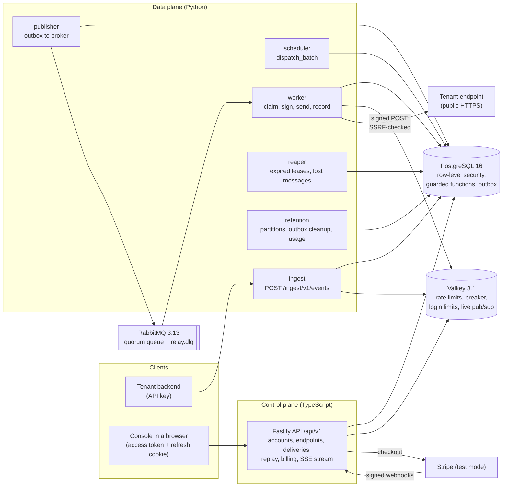
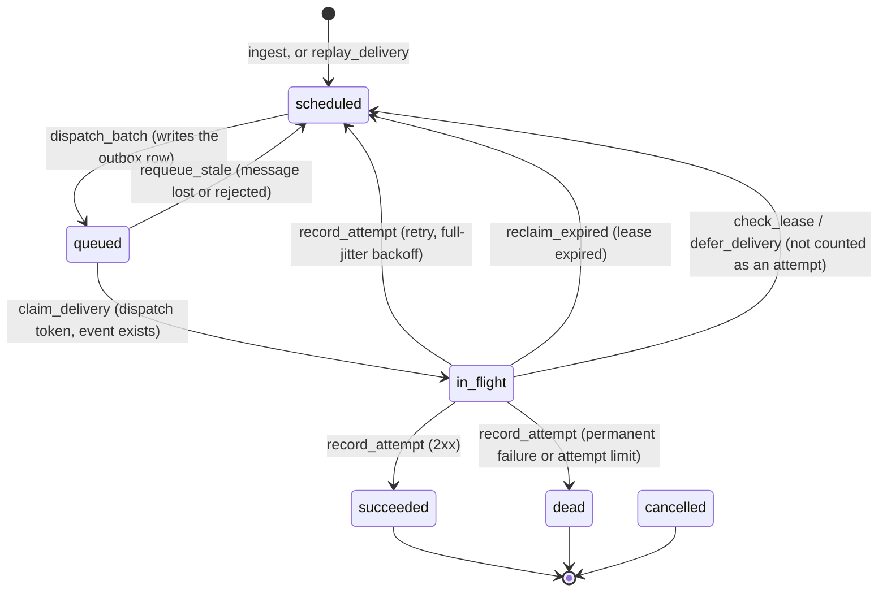

# Architecture

Relay accepts events from tenants and delivers them as signed webhooks to the tenants'
endpoints, with retries, a circuit breaker per endpoint, replay and a live view. The reasons
behind the main choices are in [`docs/adr`](adr/README.md).

## Components

How an event becomes a delivery:

1. **Ingestion** authenticates the API key, applies the tenant's rate limit and the idempotency
   key, and writes the event and one delivery per subscribed endpoint in one transaction.
2. **The scheduler** calls `dispatch_batch` tenant by tenant. It moves due deliveries to `queued`
   within the endpoint's concurrency limit and the tenant's cap, and writes one outbox row per
   delivery in the same transaction.
3. **The publisher** sends outbox rows to RabbitMQ and marks them published once the broker
   confirms them.
4. **A worker** claims the delivery with its dispatch token (`claim_delivery`), checks that its
   lease outlives the request, signs the payload (Standard Webhooks) and sends it through the
   SSRF-checked sender. It records the outcome (`record_attempt`) and only then acknowledges the
   message.
5. **The reaper** reclaims deliveries whose lease expired and requeues queued deliveries whose
   message was lost.
6. **Live updates**: workers publish `delivery` and `breaker` events on `relay:live:<tenant>`,
   and the control plane relays the tenant's own channel as server-sent events at `/api/v1/stream`.

## Delivery states

Every transition is made by a SECURITY DEFINER function that checks the current status and the
caller's dispatch or lease token, and changes nothing when a check fails.

Notes:

- `cancelled` is an allowed status in the schema, but no function sets it yet.
- A replay never changes the original delivery. It creates a new delivery that starts in
  `scheduled`: a succeeded delivery's replay gets a new webhook id, a dead one's reuses the
  original id, and a delivery whose payload has passed retention cannot be replayed.
- When an endpoint's breaker opens (`open_breaker`), its scheduled deliveries move past the
  reopen time without using attempts. After the cool-down, one probe delivery decides whether
  the breaker closes.

## Tenant isolation

Each process connects as its own database role. Tenant-scoped tables have forced row-level
security keyed on the transaction setting `app.tenant_id`, and no role is a superuser or has
BYPASSRLS. See [ADR 0003](adr/0003-row-level-security-for-tenant-isolation.md).

## Hosting (planned, not yet deployed)

One k3s node on Oracle Cloud Always Free. Traefik serves a single origin: `/` for the console,
`/api` for the control plane and `/ingest` for ingestion. See
[ADR 0005](adr/0005-oracle-always-free-with-k3s.md) and [ADR 0006](adr/0006-no-vercel.md).
